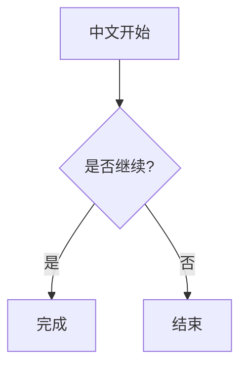
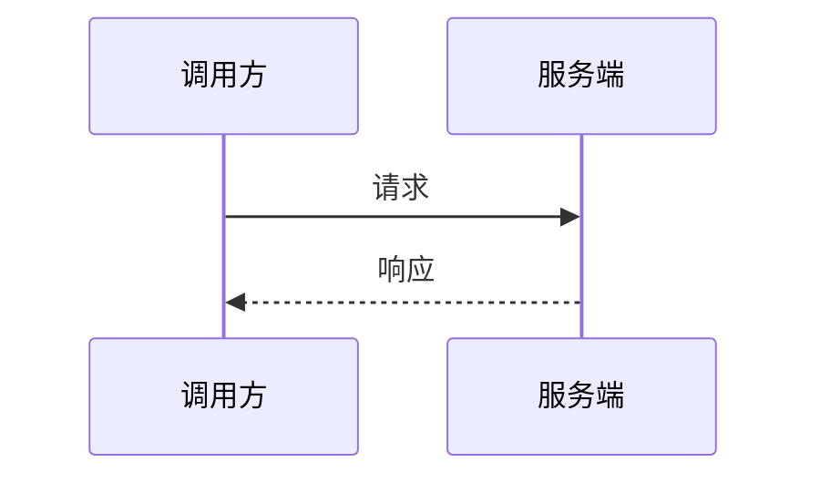

# Mermaid 复制验收

复制下面的“前文 + 表格 + 两张图 + 后文”，验证飞书保留全部内容及顺序。

前文：**加粗**与普通文字。

| 项目 | 值 |
| --- | --- |
| 复制范围 | 表格和绘图 |

两图之间的文字。

后文：只选中部分文字时，不应包含剩余文字。

## 验收步骤

1. 安装本次构建的插件 ZIP 并重启 IDEA，打开本文档的 JCEF 纯预览或分栏预览。
2. 只选中第一张图的标签文字，按 Control+Command+C，再粘贴到飞书测试文档，应得到完整 Mermaid 源码代码块；点击但未选中时应提示先选择。
3. 连续选中前文、表格、两张图和后文，再复制粘贴，应保留全部内容及顺序，每张绘图均为完整源码代码块，图标、tooltip 和 SVG 不应出现在复制 HTML 中。
4. 粘贴到纯文本编辑器，应得到 Mermaid 围栏源码及所选普通文字，不应出现重复的 SVG 标签文字。
5. 修改源码并等待预览更新，再复制，应使用新源码。连续复制两次，不应生成飞书 root、ID、ace-line 或记录 JSON。
6. 修改 Keymap 后验证新快捷键仅触发一次；普通 Command+C 和 Markdown 源文件状态应保持原行为。

本文件是人工验收夹具，不代表真实 IDEA/飞书验收已经通过。请记录 IDEA 和飞书版本、日期、单图/多图/混合选区结果。
